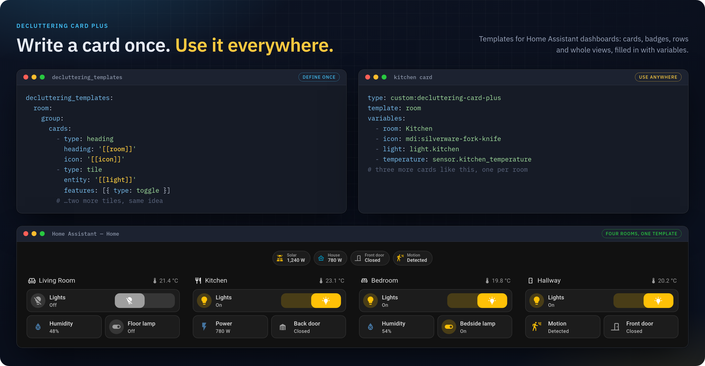
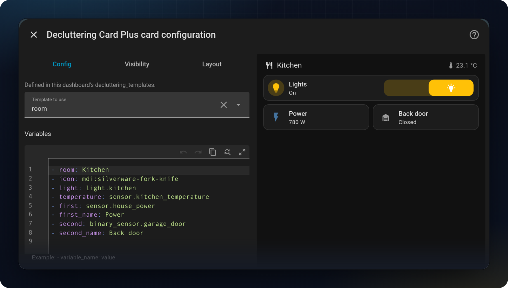

<h1 align="center">Decluttering Card Plus</h1>

<p align="center">
  <strong>Card templates for Home Assistant dashboards. Write a card once, use it everywhere.</strong><br>
  Reusable cards, badges, rows and whole views, with variables, repeats over what Home Assistant
  knows, and visual editors. The name comes from the original decluttering-card it continues.
</p>

<p align="center">
  <a href="https://github.com/tempus2016/decluttering-card-plus/releases"></a>
  <a href="https://github.com/hacs/default"></a>
  <a href="https://github.com/tempus2016/decluttering-card-plus/blob/main/LICENSE"></a>
  
  <a href="https://github.com/tempus2016/decluttering-card-plus/releases"></a>
</p>

<p align="center">
  <a href="https://github.com/tempus2016/decluttering-card-plus/actions/workflows/build.yml"></a>
  <a href="https://github.com/tempus2016/decluttering-card-plus/actions/workflows/hacs.yml"></a>
  <a href="https://github.com/tempus2016/decluttering-card-plus/commits/main"></a>
  <a href="https://community.home-assistant.io/t/decluttering-card-plus-a-maintained-continuation-of-decluttering-card-badges-cross-dashboard-templates-repeat/1021962"></a>
</p>

We all use the same block of configuration over and over across a Lovelace dashboard, and none
of us want to change the same thing in a hundred places. Define it once as a template, pass in
what differs, and use it everywhere.



📖 **The documentation is in the [wiki][wiki]**, also published as a [searchable site][pages]
with a [template builder][builder] and a [placeholder playground][playground]. This page is
the summary. What changed in each version is on the [releases page][releases].

## Installation

The card is in the HACS default list. Open HACS, search for *Decluttering Card Plus*, download
it and reload your browser. HACS adds the dashboard resource for you.

[](https://my.home-assistant.io/redirect/hacs_repository/?owner=tempus2016&repository=decluttering-card-plus&category=lovelace)

To install by hand, save every `.js` file of the [latest release][latest-release] to
`<config>/www/` *(v2.4.0+: the editors and translations are files of their own beside the main
one)* and add `/local/decluttering-card-plus.js` as a dashboard resource of type `module`. The
[Installation][wiki-installation] page has the detail.

| You need | For |
| --- | --- |
| 2024.7 | everything, unless it is listed below |
| 2024.8 | `badge:` templates |
| 2024.11 | `grid_options`, which is what the sections view reads |

## A first template

Define the template at the root of your dashboard configuration, level with `views:`:

```yaml
decluttering_templates:
  room_light:
    card:
      type: tile
      entity: '[[light]]'
      name: '[[room]]'
```

Then use it as many times as you like, filling in the holes:

```yaml
type: custom:decluttering-card-plus
template: room_light
variables:
  - light: light.living_room
  - room: Living Room
```

Templates can also be defined as a card on the dashboard itself, with a visual editor and a
live preview, if you would rather not touch YAML. [Quick Start][wiki-quickstart] goes on from
here.



*Picking a template and setting its variables in the visual editor, with a live preview.*

## What it can do

- [Cards][wiki-cards], [badges][wiki-badges], [Entities rows][wiki-rows] and
  [Picture elements][wiki-elements] — a template can hold any of the four, or a `group:` of
  several cards that sit in a section as if each were written there.
- [Variables][wiki-variables] with defaults, fallbacks (`[[name|default:Unnamed]]`),
  conditions (`[[name|if:other]]`), transforms (`[[room|slug]]`, `[[watts|div:1000]]`),
  values read from Home Assistant (`[[entity|friendly_name]]`, its area, floor, device or
  labels), and values a whole dashboard, view or section sets for every card in it.
- [Repeating a template][wiki-repeating] — one copy per item in a list, or per entity, area,
  device, floor or label Home Assistant knows about, filtered, sorted and grouped.
  [Whole sections or views][wiki-repeating-sections] can be repeated too.
- [List entries][wiki-list-entries] — `with:` and `repeat:` fill a block of config into a
  card's own lists, where a nested card cannot go.
- [Sharing templates between dashboards][wiki-sharing-between], or from one library
  dashboard to all of them, plus templates [shared by other people][discussions-share],
  carrying their author, licence, requirements and the questions to ask on install.
- Templates built on templates with `extends:`, and one-off tweaks with a card's own
  `card:` block laid over what its template builds.
- [Visibility][wiki-visibility] and [styling][wiki-styling] inside a template.
- [Visual editors][wiki-editors] that show what a card builds, where a template is used,
  rename a template or a variable everywhere, turn existing cards into a template, and keep
  the last 20 deleted or replaced templates to restore. Variables are edited as rows, with
  help beside each field, and a template can show or hide its fields depending on the others.
- A health panel for missing templates, unset variables and unused templates, and
  `debug: report` to write up what a card built, ready to paste into an issue.

The [Configuration Reference][wiki-config] lists every option.

## Is this the right card?

| You want | Reach for |
| --- | --- |
| The same block of card YAML in a dozen places, with a few values changed | **this card** |
| A card per light, room or sensor, kept up to date as you add things | **this card** — [`for_each_from`][wiki-repeating] |
| A list that reorders itself by what is on, or hides what is off *right now* | [auto-entities][auto-entities] — this card builds once and does not follow state |
| One button styled every possible way, with heavy CSS and JS templating | [button-card][button-card] and its own templates |
| To compute a value from several entities | a Home Assistant [template sensor][template-sensor], then show it with any card |

They coexist happily: a template here can hold a button-card, and an auto-entities card can
hold cards built from a template here.

To try it without touching your own dashboards, paste
[`examples/demo-dashboard.yaml`](examples/demo-dashboard.yaml) into a new dashboard's raw
configuration editor. [Trying It Out][wiki-trying] has more ways in.

## Migrating

**From `decluttering-card`, your existing configuration keeps working.** This card also
registers the original `custom:decluttering-card` and `custom:decluttering-template` types
when the original is not installed, and `decluttering_templates` is unchanged. Install this,
remove the old card, and change nothing else. Do not run both: whichever loads first claims
the type names. [Migrating from decluttering-card][wiki-migrating] has the detail.

**From Streamline card**, rename `streamline_templates:` to `decluttering_templates:` and
`custom:streamline-card` to `custom:decluttering-card-plus`. `_javascript` keys are not run
here; [Migrating from Streamline card][wiki-migrating-streamline] shows what to use instead.

## Help and languages

Common problems are in [Troubleshooting][wiki-troubleshooting]. If you need to ask, put
`debug: report` on the card and paste what it gives you into an [issue][issues] or the
[forum thread][forum].

The card speaks Dutch, English, French, German, Portuguese and Spanish, following your Home
Assistant profile. Adding a language is one file and no code: see
[Translations][wiki-translations].

## Credits

`decluttering-card-plus` builds on [custom-cards/decluttering-card][upstream], which has not had
a release since April 2023, and on the work of three people:

- [RomRider][romrider] — the original card.
- [j9brown][j9brown] — visual editors, and support for templating entity rows and picture
  elements as well as cards ([upstream PR #78][pr78], unmerged).
- [simbaja][simbaja] — modernisation to lit 3 and TypeScript 5, plus the `style` option.

This project is maintained by [tempus2016](https://github.com/tempus2016) and is copyright 2026
John MacKinnon. It began as a fork of RomRider's `decluttering-card`, which is copyright 2018
Alexandre Garcia, and parts of that original card remain in it — so both notices are carried in
[LICENSE](LICENSE). Everything here is MIT licensed, as was all of the work it builds on.

## Contributing

[CONTRIBUTING.md](CONTRIBUTING.md) covers building, testing, the commit format releases are
cut from, and the handful of changes that tend to get pushed back. Security reports go
through [SECURITY.md](SECURITY.md).

```bash
npm install     # or npm ci
npm test        # unit tests
npm run build   # lint, then bundle into dist/
npm start       # rebuild on change, served on :5000 for the dev container
```

[builder]: https://tempus2016.github.io/decluttering-card-plus/builder.html
[discussions-share]: https://github.com/tempus2016/decluttering-card-plus/discussions/categories/share-your-templates
[forum]: https://community.home-assistant.io/t/decluttering-card-plus-a-maintained-continuation-of-decluttering-card-badges-cross-dashboard-templates-repeat/1021962
[issues]: https://github.com/tempus2016/decluttering-card-plus/issues
[j9brown]: https://github.com/j9brown/decluttering-card
[latest-release]: https://github.com/tempus2016/decluttering-card-plus/releases/latest
[pages]: https://tempus2016.github.io/decluttering-card-plus/
[playground]: https://tempus2016.github.io/decluttering-card-plus/playground.html
[pr78]: https://github.com/custom-cards/decluttering-card/pull/78
[releases]: https://github.com/tempus2016/decluttering-card-plus/releases
[romrider]: https://github.com/RomRider
[simbaja]: https://github.com/simbaja/ha-decluttering-card
[upstream]: https://github.com/custom-cards/decluttering-card
[wiki]: https://github.com/tempus2016/decluttering-card-plus/wiki
[wiki-badges]: https://github.com/tempus2016/decluttering-card-plus/wiki/Badges
[wiki-cards]: https://github.com/tempus2016/decluttering-card-plus/wiki/Cards
[wiki-config]: https://github.com/tempus2016/decluttering-card-plus/wiki/Configuration-Reference
[wiki-editors]: https://github.com/tempus2016/decluttering-card-plus/wiki/Visual-Editors
[wiki-elements]: https://github.com/tempus2016/decluttering-card-plus/wiki/Elements
[wiki-installation]: https://github.com/tempus2016/decluttering-card-plus/wiki/Installation
[wiki-list-entries]: https://github.com/tempus2016/decluttering-card-plus/wiki/List-Entries
[wiki-migrating]: https://github.com/tempus2016/decluttering-card-plus/wiki/Migrating-from-decluttering-card
[wiki-migrating-streamline]: https://github.com/tempus2016/decluttering-card-plus/wiki/Migrating-from-Streamline-card
[wiki-quickstart]: https://github.com/tempus2016/decluttering-card-plus/wiki/Quick-Start
[wiki-repeating]: https://github.com/tempus2016/decluttering-card-plus/wiki/Repeating-a-Template
[wiki-repeating-sections]: https://github.com/tempus2016/decluttering-card-plus/wiki/Repeating-Sections
[wiki-rows]: https://github.com/tempus2016/decluttering-card-plus/wiki/Rows
[wiki-sharing-between]: https://github.com/tempus2016/decluttering-card-plus/wiki/Sharing-Templates-Between-Dashboards
[wiki-styling]: https://github.com/tempus2016/decluttering-card-plus/wiki/Styling
[wiki-translations]: https://github.com/tempus2016/decluttering-card-plus/wiki/Translations
[wiki-troubleshooting]: https://github.com/tempus2016/decluttering-card-plus/wiki/Troubleshooting
[wiki-trying]: https://github.com/tempus2016/decluttering-card-plus/wiki/Trying-It-Out
[wiki-variables]: https://github.com/tempus2016/decluttering-card-plus/wiki/Variables
[wiki-visibility]: https://github.com/tempus2016/decluttering-card-plus/wiki/Visibility

[auto-entities]: https://github.com/thomasloven/lovelace-auto-entities
[button-card]: https://github.com/custom-cards/button-card
[template-sensor]: https://www.home-assistant.io/integrations/template/
